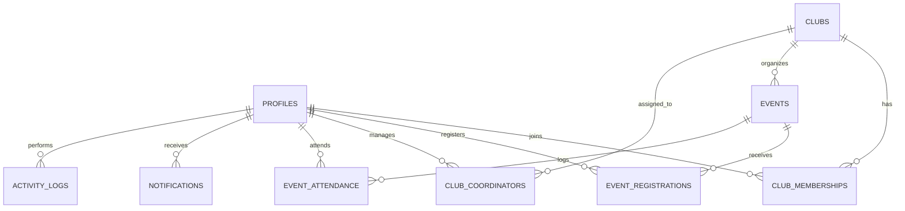

# GEC ClubSphere — Relational Database Schema Specification

**Institution:** Goa College of Engineering (GEC), Farmagudi, Goa  
**DBMS:** PostgreSQL 15+ / Supabase  
**Design Level:** 3rd Normal Form (3NF)  

---

## 1. Entity-Relationship Overview



---

## 2. Table Definitions

### 2.1 Table: `profiles`
Stores extended user profile information linked to Supabase authentication.

| Column | Type | Constraints | Description |
| :--- | :--- | :--- | :--- |
| `id` | UUID | PRIMARY KEY, REFERENCES auth.users(id) | Unique user identifier |
| `full_name` | TEXT | NOT NULL | Student/Faculty full legal name |
| `email` | TEXT | UNIQUE, NOT NULL | College email address (`*@gec.ac.in`) |
| `roll_number` | TEXT | NULLABLE | Student Roll No. (e.g. `24IT018`) |
| `department` | TEXT | NULLABLE | Engineering branch |
| `academic_year`| TEXT | CHECK IN ('FE','SE','TE','BE') | Year of study |
| `profile_photo`| TEXT | NULLABLE | Image URL |
| `role` | user_role_type| NOT NULL, DEFAULT 'student' | Role (`student`, `club_coordinator`, etc.) |
| `phone` | TEXT | NULLABLE | Mobile contact number |
| `bio` | TEXT | NULLABLE | Self description |
| `created_at` | TIMESTAMPTZ | DEFAULT now() | Account creation timestamp |

### 2.2 Table: `clubs`
Stores official student clubs and co-curricular organizations.

| Column | Type | Constraints | Description |
| :--- | :--- | :--- | :--- |
| `id` | UUID | PRIMARY KEY, DEFAULT uuid_generate_v4() | Club primary key |
| `name` | TEXT | UNIQUE, NOT NULL | Official name of club |
| `slug` | TEXT | UNIQUE, NOT NULL | URL slug (e.g. `gec-coders-club`) |
| `category` | club_category_type| NOT NULL | Domain (Technical, Cultural, Sports, etc.) |
| `tagline` | TEXT | NOT NULL | Short motto |
| `description`| TEXT | NOT NULL | Detailed charter |
| `logo_url` | TEXT | NOT NULL | Emblem/Badge URL |
| `banner_url`| TEXT | NOT NULL | Header background URL |
| `faculty_coordinator` | TEXT | NOT NULL | Faculty advisor name |
| `faculty_coordinator_email` | TEXT | NOT NULL | Faculty advisor email |
| `student_coordinator` | TEXT | NOT NULL | Student lead name |
| `student_coordinator_email` | TEXT | NOT NULL | Student lead email |
| `meeting_info` | TEXT | NOT NULL | Schedule & room location |
| `member_count` | INTEGER | DEFAULT 0, NOT NULL | Automatically updated via trigger |
| `status` | TEXT | CHECK IN ('active', 'inactive') | Current club status |

### 2.3 Table: `club_memberships`
Junction table linking students to clubs.

| Column | Type | Constraints | Description |
| :--- | :--- | :--- | :--- |
| `id` | UUID | PRIMARY KEY | Membership primary key |
| `user_id` | UUID | REFERENCES profiles(id) ON DELETE CASCADE | Student ID |
| `club_id` | UUID | REFERENCES clubs(id) ON DELETE CASCADE | Club ID |
| `membership_status` | membership_status_type | DEFAULT 'pending' | `pending`, `approved`, `rejected` |
| `role_in_club` | TEXT | DEFAULT 'member' | `member`, `core_team`, `lead` |
| `joined_at` | TIMESTAMPTZ | DEFAULT now() | Application timestamp |

*(Unique constraint on `(user_id, club_id)` prevents duplicate applications).*

### 2.4 Table: `events`
Campus hackathons, workshops, fests, and athletic tournaments.

| Column | Type | Constraints | Description |
| :--- | :--- | :--- | :--- |
| `id` | UUID | PRIMARY KEY | Event primary key |
| `club_id` | UUID | REFERENCES clubs(id) ON DELETE CASCADE | Organizing club |
| `title` | TEXT | NOT NULL | Event headline |
| `slug` | TEXT | UNIQUE, NOT NULL | URL slug |
| `description`| TEXT | NOT NULL | Event details & rules |
| `event_category`| event_category_type | NOT NULL | Hackathon, Workshop, Fest, etc. |
| `event_date` | DATE | NOT NULL | Date of event |
| `start_time` | TIME | NOT NULL | Start time |
| `end_time` | TIME | NOT NULL | End time |
| `venue` | TEXT | NOT NULL | Location on GEC campus |
| `max_participants` | INTEGER | NOT NULL, DEFAULT 100 | Seat capacity limit |
| `current_participants` | INTEGER | NOT NULL, DEFAULT 0 | Count of confirmed registrants |
| `status` | event_status_type | DEFAULT 'upcoming' | `upcoming`, `completed`, `cancelled` |

### 2.5 Table: `event_registrations`
Participant registration records and tickets.

| Column | Type | Constraints | Description |
| :--- | :--- | :--- | :--- |
| `id` | UUID | PRIMARY KEY | Registration record ID |
| `event_id` | UUID | REFERENCES events(id) ON DELETE CASCADE | Event ID |
| `user_id` | UUID | REFERENCES profiles(id) ON DELETE CASCADE | Student attendee ID |
| `registration_status`| registration_status_type | DEFAULT 'confirmed' | `confirmed`, `cancelled`, `waitlisted` |
| `registered_at`| TIMESTAMPTZ | DEFAULT now() | Timestamp of registration |

*(Unique constraint on `(event_id, user_id)` guarantees duplicate prevention).*

### 2.6 Table: `event_attendance`
Live event check-in records for AICTE activity point accreditation.

| Column | Type | Constraints | Description |
| :--- | :--- | :--- | :--- |
| `id` | UUID | PRIMARY KEY | Attendance ID |
| `event_id` | UUID | REFERENCES events(id) ON DELETE CASCADE | Event ID |
| `user_id` | UUID | REFERENCES profiles(id) ON DELETE CASCADE | Student ID |
| `attendance_status` | attendance_status_type | NOT NULL | `present`, `absent` |
| `marked_at` | TIMESTAMPTZ | DEFAULT now() | Check-in timestamp |

---

## 3. Automated Triggers

```sql
-- Automatically increments or decrements club member_count on approval/removal
CREATE OR REPLACE FUNCTION update_club_member_count()
RETURNS TRIGGER AS $$
BEGIN
  IF TG_OP = 'INSERT' AND NEW.membership_status = 'approved' THEN
    UPDATE public.clubs SET member_count = member_count + 1 WHERE id = NEW.club_id;
  ELSIF TG_OP = 'UPDATE' THEN
    IF OLD.membership_status != 'approved' AND NEW.membership_status = 'approved' THEN
      UPDATE public.clubs SET member_count = member_count + 1 WHERE id = NEW.club_id;
    ELSIF OLD.membership_status = 'approved' AND NEW.membership_status != 'approved' THEN
      UPDATE public.clubs SET member_count = GREATEST(0, member_count - 1) WHERE id = NEW.club_id;
    END IF;
  ELSIF TG_OP = 'DELETE' AND OLD.membership_status = 'approved' THEN
    UPDATE public.clubs SET member_count = GREATEST(0, member_count - 1) WHERE id = OLD.club_id;
  END IF;
  RETURN NULL;
END;
$$ LANGUAGE plpgsql;
```
