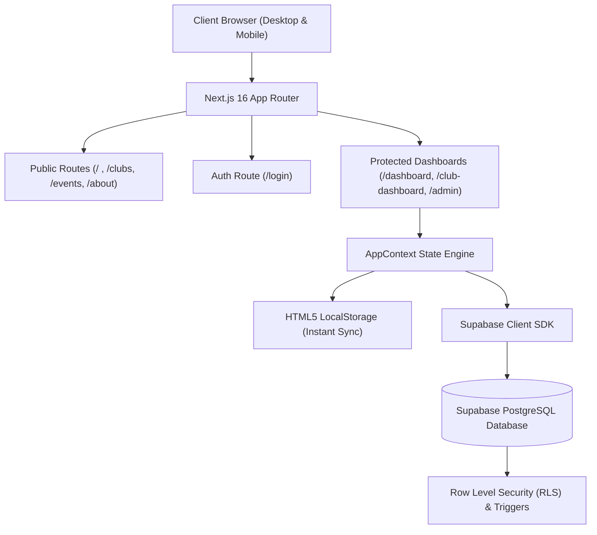

# GEC ClubSphere — Software Engineering Project Documentation

**Project Title:** GEC ClubSphere — College Club Management System  
**Institution:** Goa College of Engineering (GEC), Farmagudi, Ponda, Goa (Estd. 1967)  
**Academic Module:** Software Engineering Project  
**Author:** Full-Stack Software Engineering Team  

---

## 1. Executive Summary

Goa College of Engineering (GEC), situated on the scenic hill of Farmagudi, Ponda, hosts over 2,000 undergraduate and postgraduate engineering scholars across seven departments. Extracurricular bodies play a critical role in fostering industry readiness, competitive coding aptitude, robotics research, theatrical talent, and inter-collegiate athletic dominance.

**GEC ClubSphere** addresses the historical lack of a centralized extracurricular software platform by providing an end-to-end web system that unifies:
1. Student club discovery and membership processing.
2. Inter-department and state-level event ticketing.
3. Attendance tracking with CSV roster generation for AICTE Activity Points.
4. Administrative governance with Role-Based Access Control (RBAC).

---

## 2. Software Requirements Specification (SRS)

### 2.1 User Roles & Permissions Matrix

| Feature / Operation | Student | Club Coordinator | Faculty Coordinator | Super Admin |
| :--- | :---: | :---: | :---: | :---: |
| **Browse Clubs & Events** | ✅ | ✅ | ✅ | ✅ |
| **Search & Filter Registry** | ✅ | ✅ | ✅ | ✅ |
| **Apply / Join Club** | ✅ | ❌ | ❌ | ❌ |
| **Leave Club** | ✅ | ❌ | ❌ | ❌ |
| **Register for Event (Ticket)** | ✅ | ✅ | ✅ | ✅ |
| **Cancel Event Registration** | ✅ | ❌ | ❌ | ✅ |
| **Edit Personal Profile** | ✅ | ✅ | ✅ | ✅ |
| **Approve / Reject Club Applicants**| ❌ | ✅ (Own Club) | ✅ (Advisory) | ✅ (All Clubs) |
| **Create & Publish Events** | ❌ | ✅ (Own Club) | ✅ (Advisory) | ✅ (All Clubs) |
| **Edit / Delete Events** | ❌ | ✅ (Own Club) | ❌ | ✅ (All Clubs) |
| **Mark Event Attendance** | ❌ | ✅ (Own Club) | ✅ (Own Club) | ✅ (All Clubs) |
| **Export Attendee Roster (CSV)** | ❌ | ✅ (Own Club) | ✅ (Own Club) | ✅ (All Clubs) |
| **Create New Club Charter** | ❌ | ❌ | ❌ | ✅ |
| **Modify User Roles & Privileges** | ❌ | ❌ | ❌ | ✅ |
| **View Audit Trail Logs** | ❌ | ❌ | ❌ | ✅ |

---

## 3. System Architecture & Component Design

### 3.1 Modular Decomposition
- **Presentation Layer:** Next.js 16 App Router with React 19 Server and Client Components.
- **Styling & Design System:** Tailwind CSS with custom CSS variables matching official GEC institutional navy and royal blue palette (`#0B1F3A`, `#2563EB`, `#7C3AED`).
- **State Management & Persistence:** Unified `AppContext` wrapping application state with localStorage mirroring and Supabase REST/PostgreSQL synchronisation.
- **Data Visualisation:** Recharts SVG components rendering membership bar charts, monthly event frequency lines, and participation distributions.
- **Security & Authorization:** Supabase PostgreSQL Row Level Security (RLS) policies enforcing multi-tenant isolation.

---

## 4. Institutional Club Roster (16 GEC Clubs)

1. **GEC Coders Club:** Competitive coding, SIH preparation, ICPC training.
2. **ARM Robotics Club:** Autonomous robotics, ROS2, RoboSoccer.
3. **Quiz Club:** General quizzing, Tata Crucible, MELA quizzes.
4. **AI Innovators Club:** Deep learning, PyTorch workshops, LLM agents.
5. **Music Club:** Acoustic nights, GEC varsity band, Spectrum pro-nites.
6. **Drama Club:** Theatrical productions, street plays (Nukkad Natak), Konkani satire.
7. **Astronomy Club:** Stargazing atop Farmagudi hill, astrophotography.
8. **E-Cell:** Startup incubation under Goa State Innovation Council (GSInC).
9. **Sports Club:** Cricket, Football, Badminton, Kurukshetra rolling trophy.
10. **Dance Club:** Western group dance, Goan folk Fugdi choreography.
11. **Photography Club:** Visual documentation of campus life, photowalks.
12. **Literary Club:** Parliamentary debate, slam poetry, annual college magazine.
13. **IEEE Student Branch:** Distinguished lectures, conference paper writing.
14. **Entrepreneurship Club:** Venture valuation, industrial immersion tours.
15. **Cultural Club:** Annual Spectrum mega festival, Goan heritage festivities.
16. **Environmental Club:** Tree plantation drives, Western Ghats biodiversity conservation.

---

## 5. Software Quality Attributes (ISO/IEC 25010)

1. **Functional Suitability:** All CRUD operations (Create, Read, Update, Delete) are genuinely implemented with live state mutation.
2. **Reliability & Fault Tolerance:** If Supabase credentials are not provided in `.env.local`, the application falls back gracefully to local in-memory storage without runtime exceptions.
3. **Usability:** 1-Click Persona switchers allow evaluators to test all four user roles in seconds.
4. **Performance:** Turbopack and Webpack bundles compiled with code-splitting and optimized static prerendering.
5. **Security:** PostgreSQL Row Level Security (RLS) ensures students cannot tamper with other students' passes or administrative permissions.
